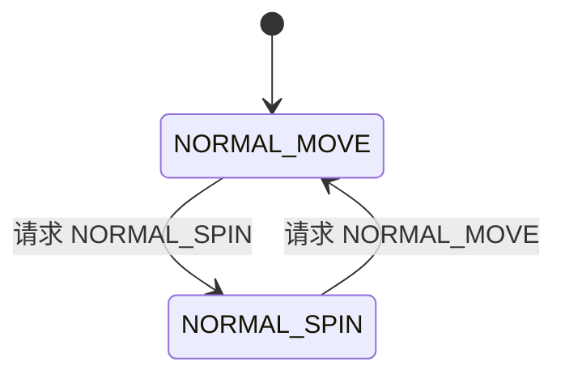

# NORMAL 平衡任务状态机技术说明

更新日期：2026-10-18。

## 1. 目的与实现范围

在原有顶层 `NORMAL` 平衡阶段内，用明确的两状态机选择正常运动和原地小陀螺。两种状态继续共用 LQR、腿长控制、LESO、VMC 与 CAN 输出链路。

初版生产改动涉及现有底盘任务及头文件、LQR、LESO；本次仅将遥控入口调整为 S2 上档直接请求 SPIN，固定角速度目标默认为 +3 rad/s。状态请求及原始运动目标由遥控任务持续更新，继续复用现有子状态机和控制链路。iw 字段及解析保留，不参与运动控制。

参考南航金城 HERO_LEG：陀螺期间取消位移与航向角位置反馈；切回正常运动时立即恢复。速度目标使用当前工程已有 `ramp_init()` / `ramp_calc()` 平滑更新。没有反馈权重斜坡、停转确认、第三个过渡状态或独立 yaw PID。

## 2. 顶层阶段与子状态

原顶层 `Chassis.chassis_mode` 仍表示自起、交接、NORMAL、零力阶段。新的子状态仅在 ONLINE、顶层 NORMAL 且六个电机反馈齐全时参与控制。

```c
typedef enum
{
    NORMAL_MOVE = 0,
    NORMAL_SPIN
} Chassis_Normal_State_e;
```

| 字段 | 所有者与含义 |
|---|---|
| `Chassis.normal_state_request` | 遥控任务持续写入的请求；枚举值0为 MOVE、1为 SPIN，Watch主要观察 |
| `Chassis.normal_state` | 底盘任务更新的当前状态；观察用，不应作为请求入口 |



重复请求不会重复执行进入动作，非法请求值保持当前状态。状态转换当拍即运行新状态，LQR 同拍按新状态选择反馈项。

| 转换 | 一次性转换动作 |
|---|---|
| MOVE → SPIN | 清零 `body_state.x` 和 `start_situate_flag`；航向参考对齐当前 yaw；保留速度斜坡输出 |
| SPIN → MOVE | 清零 `body_state.x` 和 `start_situate_flag`；航向参考对齐当前 yaw；保留速度斜坡输出 |

底盘周期中，OFFLINE、离开顶层 NORMAL 或电机反馈不齐时，当前状态和请求复位为 MOVE，有效速度及斜坡输出清零，斜坡初始化标志失效。遥控在未使能或未进入 NORMAL 时也只写入 MOVE 请求。上电、失联或无效 S2 后仍须先收到有效下档，再切中档或上档解锁使能；上档不会跳过自起。自起完成进入 NORMAL 后，遥控按保持的上档自动请求 SPIN，不要求再次拨动。

自起完成当拍只完成原顶层交接，仍发送该拍自起输出。下一拍才运行 NORMAL 状态机，根据届时的遥控请求选择状态，不抢占最后一帧自起控制。没有有效 SPIN 请求时默认 MOVE。

## 3. S2 操作与 Watch

| 操作 | 正常平衡阶段的行为 |
|---|---|
| S2 最上档 | 请求 SPIN，固定角速度目标 +3 rad/s |
| S2 中档 | 请求 MOVE，恢复原 ch0 转向输入 |
| S2 下档、无效输入或失联 | OFFLINE，运动指令归零、请求 MOVE |

iw 的零值、正负、幅值及 ch0 输入均不影响 SPIN 的状态和转速。S2 切到中档后，状态及位置反馈在底盘采纳请求当拍恢复，速度参考继续沿共享斜坡收敛。S1 腿长操作、使能边沿、自起及两路上电/复联锁定继续按现有流程执行。

遥控任务的 `Remote_MapNormalState()` 仅判断 S2；`Remote_MapJoystick()` 在 SPIN 时写固定参数，在 MOVE 时保留原 ch0 映射：

```c
/* SPIN: signed fixed target, default +3 rad/s. */
yaw_set_v = REMOTE_SPIN_YAW_RADPS;

/* MOVE: original steering mapping. */
yaw_set_v = -(float)ch0 / RC_RESOLUTION * REMOTE_YAW_MAX_RADPS;
```

修改 `REMOTE_SPIN_YAW_RADPS` 的数值调整自转目标，改为负值改变 yaw 目标方向；修改后重新编译、烧录。iw 的 UART / CAN 接收字段保持原格式，仅保存供观察。实际物理旋转方向需实车确认。

`normal_state_request` 由遥控任务每周期刷新。程序或 Watch 临时修改该字段，可能在下一遥控周期被覆盖，不能作为持续手动接管入口；调试时应主要观察输入、请求、当前状态和有效目标。

| Watch 表达式 | 单位或用途 |
|---|---|
| `remote_ctrl.rc.s2` | 当前选中来源的 S2 操作 |
| `Chassis.chassis_enable` / `Chassis.chassis_mode` | 顶层运行条件与自起阶段 |
| `remote_rearm_required` | 上电、失联或无效操作后的重新使能锁定 |
| `Chassis.all_motors_online` | 六个电机反馈是否齐全 |
| `Chassis.normal_state_request` / `Chassis.normal_state` | 请求与实际子状态 |
| `Chassis.set_goal.v_set` / `Chassis.set_goal.v_ref` | 原始平移指令/平移速度参考，m/s |
| `Chassis.set_goal.yaw_set_v` / `Chassis.set_goal.yaw_v_ref` | 原始角速度目标/斜坡参考，rad/s |
| `remote_ctrl.rc.iw` | 当前来源的拨轮值，仅接收保存，不控制运动 |
| `Chassis.body_state.Estimate_dx` / `Chassis.body_state.d_yaw` | 反馈估计平移速度/IMU 偏航角速度 |
| `Chassis.body_state.x` / `Chassis.set_goal.yaw_set` | 驻车位移和航向保持参考 |
| `u[0]` / `u[2]` | LQR 位移、航向角误差；SPIN 时两者恒为0 |
| `INS.Yaw` / `INS.YawTotalAngle` | 主值角与连续累计航向角，rad |
| `Chassis.ground` | 离地检测与实际控制开关 |
| `fb_dt` / `t_sum` | 实测周期与任务执行耗时，s |

轮力矩观察 `Chassis.Wheel_Motor[1].wheel_T`（左）和 `[0].wheel_T`（右）；腿下标则是0左、1右，两组下标不同。

## 4. 原始指令与速度参考

原 `SetGoal_t.v_set`、`yaw_set_v` 保留为输入，由遥控任务每周期写入。v_set 来自 ch3；yaw_set_v 在 MOVE 请求时来自 ch0，在 SPIN 请求时取固定参数 REMOTE_SPIN_YAW_RADPS，两者都尚未经过斜坡。`v_ref`、`yaw_v_ref` 由底盘任务独占更新，是经过当前状态选择和斜坡处理、实际供 LQR 使用的目标，不是实测车速。

```text
遥控映射 normal_state_request / v_set / yaw_set_v
              ↓
同拍快照与状态选择：MOVE跟踪输入，SPIN选择0和固定角速度
              ↓
共享速度斜坡
              ↓
v_ref / yaw_v_ref → yaw参考处理 → LQR
```

MOVE 对输入的平移和转向指令都进行变化率限制；SPIN 的平移目标为0、角速度目标为本拍捕获的有符号 yaw_set_v。切换状态时不清空共享斜坡，因此有效速度不会因为状态改变被直接重新赋为0。

底盘在 `normal_mode()` 的短临界区内一次捕获请求状态、v_set和yaw_set_v，再恢复中断、执行转换和斜坡计算。两个状态处理函数都只消费本拍捕获值，不再各自读取全局指令。即使较高优先级的遥控任务在恢复中断后写入下一帧，本拍仍使用捕获的请求和目标；Watch中请求与当前状态可能短暂相差一个采样周期。

LQR 速度误差改为：

```c
u[1] = Chassis.set_goal.v_ref - Chassis.body_state.Estimate_dx;
u[3] = Chassis.set_goal.yaw_v_ref - Chassis.body_state.d_yaw;
```

位置积分仍位于反馈更新阶段，使用上一拍 `v_ref` 判断是否在运动；这是保留原周期组织的一个采样延迟。SPIN 期间强制清零位移，状态转换处理再次清零，保证切换当拍不带入旧驻车误差。

## 5. 参数与斜坡

日常操作参数集中在 `Remote_task.c` 前部，速度参考变化率仍在 `chassis_task.h`：

| 宏 | 默认值 | 所在文件与含义 |
|---|---:|---|
| `REMOTE_SPIN_YAW_RADPS` | `3.0f` | Remote_task.c，有符号固定自转目标，rad/s；负值反向 |
| `NORMAL_V_RATE_MPS2` | `2.0f` | chassis_task.h，平移速度参考最大变化率，m/s² |
| `NORMAL_YAW_RATE_RADPS2` | `3.0f` | chassis_task.h，角速度参考最大变化率，rad/s² |

默认从0升到3 rad/s约需1 s。若需要反向自转，将 REMOTE_SPIN_YAW_RADPS 改为 -3.0f。上述宏修改后需要重新编译、烧录；遥控不再使用拨轮死区或拨轮转速映射。

斜坡使用已有 `ramp_function_source_t`、`ramp_init()`、`ramp_calc()`。每拍最大变化量等于变化率乘 `fb_dt`，接近目标后直接取到目标，避免越过目标。无效、非正或超过0.05 s的周期沿用1 ms回退值。

两条速度斜坡的幅值边界使用 ±`FLT_MAX`，只负责变化率限制，不新增目标速度限幅。原输入映射和最终电机输出限幅继续发挥作用。腿长仍使用现有独立斜坡，速度状态切换不会复位腿长参考。

## 6. LQR、航向与 LESO

### 6.1 反馈项直接切换

LQR 仍用原 K 系数表和原误差限幅。SPIN 构造完误差后直接执行：

```c
u[0] = 0.0f;
u[2] = 0.0f;
```

MOVE 时恢复原位移和最短航向角误差公式，其余速度、腿角、机体姿态项继续使用原增益。没有移植 HERO 的1.2/3.0/1.4姿态倍率。

切回 MOVE 不读取实测转速作为交接条件。即使车仍在旋转，正常反馈公式也在当拍恢复，角速度参考则从当前斜坡输出逐步追踪 ch0 的正常转向输入；再次切上档也沿用同一斜坡，不重置输出。目标变化率受限不等于所有电机力矩都具有变化率限制，切换动态表现仍需实车验证。

### 6.2 航向参考处理

原 `YAW_Parameter_Processing()` 移至状态目标生成后调用，并读取 `yaw_v_ref`：SPIN 或有效角速度绝对值大于原0.1 rad/s阈值时，航向目标跟随当前实际 yaw；其余情况保持已捕获航向。

这样不会因为退出陀螺时原始转向摇杆恰为0，就在速度参考仍较大时锁住旧航向。没有新增 `top_exit_flag` 或停转等待；反馈项的恢复与原有航向参考处理分别执行。

### 6.3 连续角观测

LESO 的偏航测量由 `INS.Yaw` 改为现有 `INS.YawTotalAngle`，避免主值角跨 ±π 时把约2π的跳变送进观测器。LQR 的航向误差仍使用原主值角和 `Find_Min_RADIAN()`，其计算接口不变。

LESO 的 Ad/Bd/L、扰动限幅、轮与腿补偿参数、现有初始化/等待/渐入及接地门控均保持原值。MOVE/SPIN 之间切换不重新初始化 LESO。

## 7. 离地、禁用与周期接入

当现有离地控制开关实际生效且双腿离地时：

- 保留当前子状态，速度参考与两条速度斜坡输出归零。
- 继续沿用原空中 LQR、腿长控制和最终轮力矩清零逻辑。
- 落地后从零重新渐变到当前状态的运动目标。

如果离地控制未启用，检测标志仅用于观测，不改变速度参考。单腿离地仍由现有 LESO 接地门控处理，不新增状态机分支。状态切换不复位接地检测历史。

当前周期顺序：

```text
反馈更新（含接地检测、使用上一拍参考的驻车积分）
→ 倒地检测
→ 顶层非NORMAL时的接地复位、未运行时的子状态复位
→ 原腿长参考更新
→ 顶层模式分发
    NORMAL：请求/目标快照 → 状态转换 → switch目标更新 → yaw参考 → LQR → 腿长控制
    其他：原自起/交接/零力流程
→ LESO
→ VMC
→ 原CAN输出与最终保护
```

CAN 映射、轮左右下标、力矩转电流顺序、关节力矩限幅和最终输出保护均保持原实现。没有修改控制周期或自起动作参数。

## 8. 验证记录

2026-10-18 已完成本次 S2 固定转速接入检查。主机测试编译实际固件函数和类型，硬件/RTOS 依赖使用替身；临时源码采用 UTF-8，生产源码保持原编码。

| 命令 | 本次结果与覆盖 |
|---|---|
| `node mdk_check/remote_source_verify.js` | LOCAL 3489项、GIMBAL 3659项，均0失败；S2上档固定+3 rad/s，iw零值/正负/极值及ch0不影响SPIN，中档恢复原转向，来源隔离、保持上档跨自起、切换不新增使能事件、失联及两路复联锁定；非法配置和RTOS检查通过 |
| `node mdk_check/normal_mode_verify.js` | 底盘正、反方向各33577项通过；状态当拍转换、速度连续、反馈立即恢复、一致快照、离地、禁用、电机反馈丢失及自起最后一帧 |
| `node mdk_check/leg_length_ramp_verify.js` | 48666项通过，腿长斜坡及自起交接顺序 |
| `node mdk_check/leg_motion_verify.js` | 单腿1247、自起接口1896、集成1046项通过，各动作时长组合通过 |
| `node mdk_check/ground_contact_verify.js` | 613项、0失败 |
| `node mdk_check/leso_split_verify.js` | 320832项、0失败，含多圈连续角观测及补偿检查 |
| `node mdk_check/wheel_output_verify.js` | 117项、0失败 |
| `node mdk_check/motor_online_verify.js` | 21036项、0失败 |
| `node mdk_check/pitch_stop_verify.js` | 34100项、0失败，上电锁定、俯仰停机、失联归零及重新使能 |

LESO 测试的旧默认轮补偿断言为0.2，与本次开始前源码已使用的1.0不一致；本次仅将测试断言同步为1.0，生产 LESO 及其参数保持原字节。

Keil 使用 ArmClang V6.16 编译当前 LOCAL 配置，结果为 **0 Error(s), 0 Warning(s)**，AXF / HEX 已更新；日志为 `MDK-ARM/s2_spin_build.log`。GIMBAL 的遥控 C 分支通过主机编译检查。本次未烧录。

生产源码本次仅修改 Remote_task.c 的操作映射，其余底盘、自起、LQR / LESO、协议、RTOS 和工程配置保持本轮开始时的内容。源码编码与行尾保持；Markdown 使用 UTF-8 BOM＋CRLF。

历史验证：初版接地差分检查617项通过，VMC / Jacobian公式检查通过；数值脚本几何与固件不同，仅用于公式核对，本次未修改相关公式。

## 9. 实车验收与边界

本次未进行烧录、硬件动作或真实RTOS时序测量。主机检查能验证控制组织、目标计算和保护分支，不能证明实车稳定性、转速跟踪或物理旋转方向。

建议按以下顺序记录：

1. 上电保持 S2 中档或上档，确认仍禁止使能；有效下档后切中档，按原自起进入 NORMAL_MOVE，确认腿长、驻车和 ch0 转向行为。
2. S2 切到最上档，iw 保持零，确认请求/当前状态为 SPIN、yaw_set_v 为 +3 rad/s，平移参考渐变到零、角速度参考渐变到目标。变化 iw 和 ch0，确认固定目标不变。
3. 尚未停转时将 S2 切到中档，确认状态与 u[0]/u[2] 当拍恢复、航向参考对齐、角速度参考连续跟随 ch0；重复上/中档切换。
4. 有效下档后直接切上档并保持，确认先完成自起，再自动请求 SPIN。分别验证本地和云台失联归零、复联保持档位仍锁定、再次有效下档才允许重新使能。
5. 记录 S2、请求/当前状态、yaw_set_v、yaw_v_ref、实测 d_yaw、两轮力矩、IMU姿态及 fb_dt/t_sum；确认物理旋转方向、切换响应及已启用的离地保护。

默认3 rad/s及变化率是首版配置，不代表已经完成实车调参。
