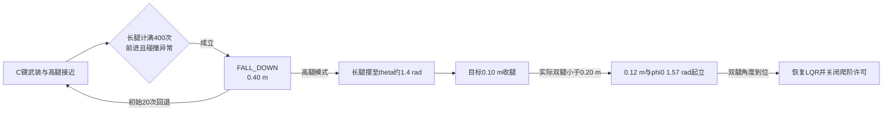
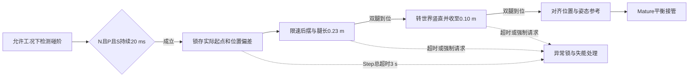

# 上台阶方案对比：HERO_LEG、SPR 与浙大

核对日期：2026-10-24。以本地当前文件为准。按最新要求重点分析 HERO_LEG、SPR 和浙大文档，其余五个目录作辅助对照。本次只整理资料，不修改固件，不编译、不烧录、不做实车测试。

## 1. 先给结论

**对当前工程，优先参考“接近台阶 → 碰阶确认 → 主动摆腿和收腿 → 姿态恢复 → 平衡接管”这条路线。HERO 最适合看清动作如何通过 F0/Tp 落到执行器，浙大最适合参考检测、轨迹和交接，SPR 适合对照另一种关节位置控制实现。**这是根据源码结构和当前固件接口作出的工程判断，不是三台车通过率的实测排名。

三者专用跨阶动作有一个共同点：**接近阶段用轮子前进，真正摆腿越阶时将主动轮驱动置零，靠腿部动作与台阶接触完成几何重构。**零电流/零力矩不等于锁住轮子，轮子仍可能被动滚动。它们也都不是靠加大正常 LQR 的速度目标一直顶上去。HERO 和 SPR 的输出链可由代码确认；浙大这点来自文档的模式输出说明。[H:1219](<E:/ROBOT_NEW/kaiyuan/leg/HERO_LEG/HERO_LEG/Chassis/Task/Src/Chassis_Task.c:1219>) [H:1256](<E:/ROBOT_NEW/kaiyuan/leg/HERO_LEG/HERO_LEG/Chassis/Task/Src/Chassis_Task.c:1256>) [S:1042](<E:/ROBOT_NEW/kaiyuan/leg/SPR Balanced-infantry/SPR Balanced-infantry/code/chassis/chassis/Task/chassis_task.c:1042>) [浙大文档，p.47](<E:/ROBOT_NEW/kaiyuan/leg/【RM2026-串联腿机器人建模与控制开源】浙江大学-HelloWorld战队/串联腿机器人建模与控制开源文档.pdf>)

| 比较项 | HERO_LEG：分段摆腿力矩 | SPR：逆解后关节双环 | 浙大：限速轨迹与分层状态机 |
|---|---|---|---|
| 资料证据 | 主任务、控制函数、发送链均可追踪 | 主任务、模式入口、发送链均可追踪 | 56 页原始文档；本地无对应固件源码 |
| 使用方式 | 键鼠短按 CTRL 武装，人工控制接近 | C 键武装并切高腿，人工控制接近 | 功能开关开放后，由姿态/速度条件触发 |
| 碰阶判断 | 每侧轮力矩请求大且腿角大；双侧锁存 | 速度特征时窗偏离正常聚类中心 | 模式/高度门槛 AND 姿态主条件 AND 至少一个辅助条件，20 ms 消抖 |
| 主动作 | 收短，同时后摆 → 前摆 → 回正子状态 | 保持长腿摆转 → 收短 → 复用起立 | 后摆到预备位并调整腿长 → 收短、转到世界竖直 |
| 核心控制量 | 分段 Tp，局部角度 PID；F0 继续由腿长环生成 | 虚拟腿目标经逆运动学，关节角/速度双环出力矩 | 文档给定腿长、机构角的限速参考；代码细节无法核对 |
| 跨阶时轮输出 | 最终两轮电流为 0 | 最终两轮电流为 0 | 文档规定两轮力矩为 0 |
| 左右协调 | 两侧独立子步；进入动作前双侧碰阶锁存 | 双腿到角后才能收腿；未锁存单腿到位 | 各阶段要求双腿几何条件满足 |
| 专用超时 | 未见 | 只有初始阶段 20 次计数回退，后续阶段未见 | Step 总超时 3 s，异常锁/强制退出 |
| 完成标准 | 双腿进入回正子状态就退出 | 复用起立，双腿 phi0 接近 1.57 rad 就退出 | 腿长/摆角到位后完成参考量交接 |
| 稳定落台确认 | 无专用确认 | 无专用确认 | Step 退出未列触地确认；不能借用 Flight 的条件来补全 |
| 首要借鉴点 | 直观的动作分段和 F0/Tp 控制权切换 | 使能/重武装、完整位置控制链 | 多条件检测、轨迹限速、原子动作、超时、无冲击交接 |

表中源码与参数出处见第 3—5 节。**三者都不能仅凭“状态机走到最后”证明轮子已稳定落在台面上。**HERO/SPR 的实测可越高度和成功率在已核对资料中未知；浙大文档也没有可据此计算上台阶通过率的测试样本统计。

## 2. 动作原理和证据边界

### 2.1 跨阶与跳跃应分开看

跨阶利用轮子受阻后机体与腿的相对运动，通过后摆、收腿、再回到支撑姿态把轮子带过阶沿。浙大第 43 页图 11 显示的是车体经过阶沿、腿从下侧绕回台面的动作；这要求当前机械具有足够的摆腿空间和合适的阶沿接触关系。**“机体哪一部分支承、承受多大冲击、是否会卡住”需要当前实物验证，源码不能确定。**[浙大文档，p.43](<E:/ROBOT_NEW/kaiyuan/leg/【RM2026-串联腿机器人建模与控制开源】浙江大学-HelloWorld战队/串联腿机器人建模与控制开源文档.pdf>)

跳跃则先蹬地获得腾空，再收腿获得净空，并处理落地。浙大把 Onestep/Twostep 与 Jump 分开；SPR 的 `CLIMB_THE_STAIRS` 与 `JumpFlag` 也是两条控制链。不能把跳跃腿长、原地跳高或下台阶表现直接当成跨阶能力。[浙大文档，p.39](<E:/ROBOT_NEW/kaiyuan/leg/【RM2026-串联腿机器人建模与控制开源】浙江大学-HelloWorld战队/串联腿机器人建模与控制开源文档.pdf>) [浙大文档，p.42](<E:/ROBOT_NEW/kaiyuan/leg/【RM2026-串联腿机器人建模与控制开源】浙江大学-HelloWorld战队/串联腿机器人建模与控制开源文档.pdf>) [S:504](<E:/ROBOT_NEW/kaiyuan/leg/SPR Balanced-infantry/SPR Balanced-infantry/code/chassis/chassis/Task/chassis_task.c:504>) [S:827](<E:/ROBOT_NEW/kaiyuan/leg/SPR Balanced-infantry/SPR Balanced-infantry/code/chassis/chassis/Task/chassis_task.c:827>)

### 2.2 阅读以下数值时的约定

- **源码事实**：实际执行语句、调用关系、参数和最终发送值；被注释的入口不算启用。
- **文档描述**：作者对实现/测试的说明，保留其证据等级，不推定已核对固件。
- **分析建议**：针对当前工程提出的改造方向，不表示已经实现。
- 本次浙大 PDF 的页面序号与页面印刷页码一致；引用直接写页码。未以演示视频作性能证据，因此不从视频文件名推断高度或成功率。
- 各项目的 `theta`、`phi0`、`Tp` 符号不同。下文参数仅表示原项目含义，不能跨项目直接粘贴。

## 3. HERO_LEG：轮力矩请求触发，分段力矩摆腿

### 3.1 实际入口和碰阶判断

主任务顺序为反馈更新、姿态/碰撞检查、遥控决策、`Bump_Control`、腿长控制、LQR、VMC、CAN 发送，动作确实接入控制周期。有效使能入口在键鼠路径：**CTRL 按下再释放，按住时间小于 500 ms**，切换 `bump_flag`；纯遥控 `Rc_Mode()` 中台阶入口已注释，实际清零标志并恢复短腿。[H:84](<E:/ROBOT_NEW/kaiyuan/leg/HERO_LEG/HERO_LEG/Chassis/Task/Src/Chassis_Task.c:84>) [H:480](<E:/ROBOT_NEW/kaiyuan/leg/HERO_LEG/HERO_LEG/Chassis/Task/Src/Chassis_Task.c:480>) [H:596](<E:/ROBOT_NEW/kaiyuan/leg/HERO_LEG/HERO_LEG/Chassis/Task/Src/Chassis_Task.c:596>) [H:354](<E:/ROBOT_NEW/kaiyuan/leg/HERO_LEG/HERO_LEG/Chassis/Task/Src/Chassis_Task.c:354>)

武装后目标腿长升至 **0.37 m**，由原来的速度指令和 LQR 控制接近。每侧同时满足：

```text
abs(T_Wheel) ≥ 5.2 N·m
AND abs(theta) ≥ 0.3 rad
```

则锁存该侧碰阶；左右都曾满足才进入动作。**T_Wheel 是上一拍未按最终电流限制折算的控制请求，不是反馈测得的轮力矩。**没有连续时间消抖，也没有左右碰阶锁存的最大间隔。单侧锁存后可以一直等另一侧。[HP:28](<E:/ROBOT_NEW/kaiyuan/leg/HERO_LEG/HERO_LEG/Chassis/Parameter_Tree/Parameter.h:28>) [HP:58](<E:/ROBOT_NEW/kaiyuan/leg/HERO_LEG/HERO_LEG/Chassis/Parameter_Tree/Parameter.h:58>) [H:235](<E:/ROBOT_NEW/kaiyuan/leg/HERO_LEG/HERO_LEG/Chassis/Task/Src/Chassis_Task.c:235>) [HL:161](<E:/ROBOT_NEW/kaiyuan/leg/HERO_LEG/HERO_LEG/Chassis/Controller/Src/LQR.c:161>) [H:1238](<E:/ROBOT_NEW/kaiyuan/leg/HERO_LEG/HERO_LEG/Chassis/Task/Src/Chassis_Task.c:1238>)

这套判据的物理含义是“控制器已经使劲推，腿也因受阻偏转”。它简单、可解释，但不能区分台阶、顶墙、卡轮或其它受阻；后半句是由这些观测量的信息范围推得的限制。

### 3.2 双腿各自的动作

| 阶段 | 原工程动作 | 转移条件 |
|---|---|---|
| 接近 | 目标腿长 0.37 m；LQR 和轮驱动正常 | 两侧碰阶锁存 |
| 后摆，step=0 | 目标腿长改为 0.13 m；通常 Tp=+6 N·m；当 `abs(abs_leg_theta)≥1.32 rad` 时改用 PID 保持 1.22 rad | 本侧 `abs(theta)≥1.2 rad` |
| 前摆，step=1 | 通常 Tp=−15 N·m；左腿在 `abs(theta)≥1.25 rad` 时有 PID 保持相对腿角 1.12 rad 的分支；右腿无此分支 | 本侧 `theta≤0.55 rad` |
| 回正，step=2 | 若该分支得到执行，则 PID 目标相对腿角为 0.18 rad | 两腿只要都进入 step=2，就清动作标志、目标腿长恢复 0.16 m |

出处：[H:987](<E:/ROBOT_NEW/kaiyuan/leg/HERO_LEG/HERO_LEG/Chassis/Task/Src/Chassis_Task.c:987>) [H:1003](<E:/ROBOT_NEW/kaiyuan/leg/HERO_LEG/HERO_LEG/Chassis/Task/Src/Chassis_Task.c:1003>) [H:1015](<E:/ROBOT_NEW/kaiyuan/leg/HERO_LEG/HERO_LEG/Chassis/Task/Src/Chassis_Task.c:1015>) [H:1054](<E:/ROBOT_NEW/kaiyuan/leg/HERO_LEG/HERO_LEG/Chassis/Task/Src/Chassis_Task.c:1054>) [H:1072](<E:/ROBOT_NEW/kaiyuan/leg/HERO_LEG/HERO_LEG/Chassis/Task/Src/Chassis_Task.c:1072>) [HP:61](<E:/ROBOT_NEW/kaiyuan/leg/HERO_LEG/HERO_LEG/Chassis/Parameter_Tree/Parameter.h:61>)


这里的 `theta` 含机体俯仰，`abs_leg_theta` 实际是相对机体的腿角，并不是对 `theta` 取绝对值；机体俯仰轴又使用 `-INS.Roll`。要按物理坐标映射，不能只照变量名称认 Pitch/Roll。[H:115](<E:/ROBOT_NEW/kaiyuan/leg/HERO_LEG/HERO_LEG/Chassis/Task/Src/Chassis_Task.c:115>) [H:131](<E:/ROBOT_NEW/kaiyuan/leg/HERO_LEG/HERO_LEG/Chassis/Task/Src/Chassis_Task.c:131>)

### 3.3 动作期间谁负责控制

- 碰阶后不再调用 `LQR_Calc` 生成反馈控制输出（增益拟合仍执行），`Bump_Control` 写的 Tp 得以保留；腿长环继续生成 F0，跨阶时关闭横滚补偿。F0/Tp 最后仍走 VMC。[H:1107](<E:/ROBOT_NEW/kaiyuan/leg/HERO_LEG/HERO_LEG/Chassis/Task/Src/Chassis_Task.c:1107>) [H:1219](<E:/ROBOT_NEW/kaiyuan/leg/HERO_LEG/HERO_LEG/Chassis/Task/Src/Chassis_Task.c:1219>) [H:1235](<E:/ROBOT_NEW/kaiyuan/leg/HERO_LEG/HERO_LEG/Chassis/Task/Src/Chassis_Task.c:1235>)
- VMC 中虽然先用旧 T_Wheel 换算电流，但随后把左右最终电流清零。因此 Watch 中 T_Wheel 非零不表示轮子还在驱动。[H:1238](<E:/ROBOT_NEW/kaiyuan/leg/HERO_LEG/HERO_LEG/Chassis/Task/Src/Chassis_Task.c:1238>) [H:1256](<E:/ROBOT_NEW/kaiyuan/leg/HERO_LEG/HERO_LEG/Chassis/Task/Src/Chassis_Task.c:1256>)
- Check_Task 中离地估计仍存在，但整车离地标志要求 `!bump_flag`，动作期间不采用该结论；重新触地也不是完成条件。[HC:45](<E:/ROBOT_NEW/kaiyuan/leg/HERO_LEG/HERO_LEG/Chassis/Task/Src/Check_Task.c:45>) [HC:103](<E:/ROBOT_NEW/kaiyuan/leg/HERO_LEG/HERO_LEG/Chassis/Task/Src/Check_Task.c:103>)
- 原参数含 **29 kg 车体质量参数、450 N 气弹簧力参数、0.06 m 轮半径**，腿轴向补偿包含弹簧几何。固定 +6/−15 N·m 是该机动作参数，不能当成一般轮腿推荐值。[HP:6](<E:/ROBOT_NEW/kaiyuan/leg/HERO_LEG/HERO_LEG/Chassis/Parameter_Tree/Parameter.h:6>) [H:139](<E:/ROBOT_NEW/kaiyuan/leg/HERO_LEG/HERO_LEG/Chassis/Task/Src/Chassis_Task.c:139>) [H:1107](<E:/ROBOT_NEW/kaiyuan/leg/HERO_LEG/HERO_LEG/Chassis/Task/Src/Chassis_Task.c:1107>)

### 3.4 最值得注意的缺口

1. **回正未确认。**两腿可以在本拍刚从 step=1 变为 2，就直接结束动作；此时甚至还没执行一次 step=2 的回正 PID。因此“回正目标 0.18 rad”不是已到位保证。[H:1024](<E:/ROBOT_NEW/kaiyuan/leg/HERO_LEG/HERO_LEG/Chassis/Task/Src/Chassis_Task.c:1024>) [H:1057](<E:/ROBOT_NEW/kaiyuan/leg/HERO_LEG/HERO_LEG/Chassis/Task/Src/Chassis_Task.c:1057>) [H:1072](<E:/ROBOT_NEW/kaiyuan/leg/HERO_LEG/HERO_LEG/Chassis/Task/Src/Chassis_Task.c:1072>)
2. **无阶段超时、无稳定落台确认。**后摆或前摆卡住时可能持续等待。仍有通用倒地、失联、STOP/ERO 和手动取消路径，不能把这点扩大为整车完全无保护。[H:987](<E:/ROBOT_NEW/kaiyuan/leg/HERO_LEG/HERO_LEG/Chassis/Task/Src/Chassis_Task.c:987>) [H:708](<E:/ROBOT_NEW/kaiyuan/leg/HERO_LEG/HERO_LEG/Chassis/Task/Src/Chassis_Task.c:708>) [H:802](<E:/ROBOT_NEW/kaiyuan/leg/HERO_LEG/HERO_LEG/Chassis/Task/Src/Chassis_Task.c:802>)
3. **两侧前摆控制不对称；入口检查也有重复。**左腿多一个角度 PID 分支，右腿直接给固定前摆力矩；键鼠使能的 slip 检查将左侧写了两次。这些应保留为原代码事实，移植时重新决定，而不是视为必要设计。[H:1015](<E:/ROBOT_NEW/kaiyuan/leg/HERO_LEG/HERO_LEG/Chassis/Task/Src/Chassis_Task.c:1015>) [H:1054](<E:/ROBOT_NEW/kaiyuan/leg/HERO_LEG/HERO_LEG/Chassis/Task/Src/Chassis_Task.c:1054>) [H:480](<E:/ROBOT_NEW/kaiyuan/leg/HERO_LEG/HERO_LEG/Chassis/Task/Src/Chassis_Task.c:480>)
4. **周期不是直接等于 1 ms。**外层任务和正常发送函数各有一次 `osDelay(1)`，RTOS tick=1 ms；正常链为约 2 ms 级等待加计算调度，须实测。不能照“1 kHz tick”抄离散 PID 或逐拍步长。[HF:225](<E:/ROBOT_NEW/kaiyuan/leg/HERO_LEG/HERO_LEG/Chassis/Src/freertos.c:225>) [H:1312](<E:/ROBOT_NEW/kaiyuan/leg/HERO_LEG/HERO_LEG/Chassis/Task/Src/Chassis_Task.c:1312>) [HRT:64](<E:/ROBOT_NEW/kaiyuan/leg/HERO_LEG/HERO_LEG/Chassis/Inc/FreeRTOSConfig.h:64>)

## 4. SPR：异常检测触发，长腿摆转后收腿起立

### 4.1 入口、武装条件与检测器

云台压缩包中的键鼠代码用 **C 键设置 mode=7、legL_mode=3**；底盘通过 CAN 接收，模式逻辑打开爬阶标志。高腿目标是 **0.44 m**。普通 mode=1 将 `skip_ClimbTheStairsFlag` 置1，mode=7仅在该值为1时开放武装；动作完成会清爬阶许可，不能理解为自动连续爬楼梯。云台源码证据位于 `gimbal.zip` 内部 `gimbal/Task/gimbal_task.c:491–505`，本次只读检查。[SZ：云台源码压缩包](<E:/ROBOT_NEW/kaiyuan/leg/SPR Balanced-infantry/SPR Balanced-infantry/code/gimbal.zip>) [SCAN:112](<E:/ROBOT_NEW/kaiyuan/leg/SPR Balanced-infantry/SPR Balanced-infantry/code/chassis/chassis/application/CAN_receive.c:112>) [SB:47](<E:/ROBOT_NEW/kaiyuan/leg/SPR Balanced-infantry/SPR Balanced-infantry/code/chassis/chassis/application/chassis_behaviour.c:47>) [SB:119](<E:/ROBOT_NEW/kaiyuan/leg/SPR Balanced-infantry/SPR Balanced-infantry/code/chassis/chassis/application/chassis_behaviour.c:119>) [S:490](<E:/ROBOT_NEW/kaiyuan/leg/SPR Balanced-infantry/SPR Balanced-infantry/code/chassis/chassis/Task/chassis_task.c:490>)

在 STANDING 中，以下条件同时满足才进入台阶模式：

```text
爬阶使能
AND 平均实际腿长 ≥ 0.29 m 的计数达到 400
AND 前进速度指令 ≥ 0.2 m/s
AND impact_is_detected()
```

400次计数在STANDING中持续累计，并非按下C后才重新开始；腿长不够时计数清零。控制宏为 1 tick、RTOS 1 kHz、循环末 `vTaskDelay(1)`，400 次标称约 **0.4 s**；这是循环计数，不是实测精确计时。[S:372](<E:/ROBOT_NEW/kaiyuan/leg/SPR Balanced-infantry/SPR Balanced-infantry/code/chassis/chassis/Task/chassis_task.c:372>) [SH:29](<E:/ROBOT_NEW/kaiyuan/leg/SPR Balanced-infantry/SPR Balanced-infantry/code/chassis/chassis/Task/chassis_task.h:29>) [SRT:64](<E:/ROBOT_NEW/kaiyuan/leg/SPR Balanced-infantry/SPR Balanced-infantry/code/chassis/chassis/Core/Inc/FreeRTOSConfig.h:64>) [S:156](<E:/ROBOT_NEW/kaiyuan/leg/SPR Balanced-infantry/SPR Balanced-infantry/code/chassis/chassis/Task/chassis_task.c:156>)

**`ClimbKNN` 名字容易误导：实际碰阶算法不是 k 近邻投票。**它将最近 8 次的 4 个速度特征拼成 32 维向量，标准化后求到 7 个正常聚类中心的最小平方距离 d²，再算正常置信度：

```text
c = exp(−d² / (37.555985 × 1.5))
c < 0.75 → 异常碰撞
时窗未满 → c = 1
```

4 个特征是机体估计速度、轮速量、两者差值、左右轮差值。它识别“偏离正常运动”，不直接识别台阶高度。更要注意：接口名叫 `wheel_avg_vel`，调用处 `wheel_dx` 却是按安装方向统一、包含机体角速度和腿角速度修正的两轮线速度之和，未除 2，并非裸编码器轮速。迁移训练参数时必须复现同样特征尺度，或重新采样训练。[SK:15](<E:/ROBOT_NEW/kaiyuan/leg/SPR Balanced-infantry/SPR Balanced-infantry/code/chassis/chassis/algorithm/ClimbKNN.c:15>) [SKM:8](<E:/ROBOT_NEW/kaiyuan/leg/SPR Balanced-infantry/SPR Balanced-infantry/code/chassis/chassis/algorithm/knn_impact_model.h:8>) [S:527](<E:/ROBOT_NEW/kaiyuan/leg/SPR Balanced-infantry/SPR Balanced-infantry/code/chassis/chassis/Task/chassis_task.c:527>)

作者在源码注释中也指出打滑和远距离接近会误判。150/200 mm 只出现在调参背景说明，不能写成已验证通过高度。[S:375](<E:/ROBOT_NEW/kaiyuan/leg/SPR Balanced-infantry/SPR Balanced-infantry/code/chassis/chassis/Task/chassis_task.c:375>)

### 4.2 动作分段

| 阶段 | 原工程目标 | 转移条件 |
|---|---|---|
| FALL_DOWN | 两腿 0.40 m，phi0=1.57 rad；轮电流 0 | 高腿模式则转 LEGS_TURN；初始计数达到 20 则回 STANDING |
| LEGS_TURN | 两腿保持 0.40 m；每拍 `phi0_set=当前phi0+0.50 rad` | 各腿 `abs(theta−1.4)<0.1 rad` 时当拍目标改成当前角；双腿同时到位后收腿 |
| LEGS_SHORT | 两腿目标 0.10 m；phi0 目标每拍跟随当前反馈 | 两腿实际腿长均<0.20 m，转 FALLING_TO_STANDING |
| FALLING_TO_STANDING | 两腿 0.12 m、phi0=1.57 rad；轮电流 0 | 双腿 phi0 误差均<0.10 rad，恢复 STANDING 并清爬阶使能 |

出处：[S:977](<E:/ROBOT_NEW/kaiyuan/leg/SPR Balanced-infantry/SPR Balanced-infantry/code/chassis/chassis/Task/chassis_task.c:977>) [S:1002](<E:/ROBOT_NEW/kaiyuan/leg/SPR Balanced-infantry/SPR Balanced-infantry/code/chassis/chassis/Task/chassis_task.c:1002>) [S:1025](<E:/ROBOT_NEW/kaiyuan/leg/SPR Balanced-infantry/SPR Balanced-infantry/code/chassis/chassis/Task/chassis_task.c:1025>) [S:481](<E:/ROBOT_NEW/kaiyuan/leg/SPR Balanced-infantry/SPR Balanced-infantry/code/chassis/chassis/Task/chassis_task.c:481>)



SPR的 `theta=rad_format(phi0−1.57−pitch)`，phi0是机体系虚拟腿角；1.4 rad是theta目标，不是phi0目标。[S:246](<E:/ROBOT_NEW/kaiyuan/leg/SPR Balanced-infantry/SPR Balanced-infantry/code/chassis/chassis/Task/chassis_task.c:246>)

`当前phi0+0.50` 是目标领先反馈的角度差，**不是 0.50 rad/s，也不是每拍保证转过 0.50 rad**。已到角度的腿也没有完成锁存，偏离窗口后会重新推进。收腿时目标每拍跟随当前角，不能理解为保持一个锁存的世界系落脚点。

### 4.3 与 HERO 的控制区别及限制

跨阶控制用 `LegToJoint(L,phi0)` 逆运动学得到关节目标，再用关节角度环和速度环输出力矩；正常 STANDING 才走 LQR/VMC 的力分配。台阶函数清轮电流之后不会再被站立的功率分配重写。关节发送由独立 send_task 执行。[S:1042](<E:/ROBOT_NEW/kaiyuan/leg/SPR Balanced-infantry/SPR Balanced-infantry/code/chassis/chassis/Task/chassis_task.c:1042>) [S:793](<E:/ROBOT_NEW/kaiyuan/leg/SPR Balanced-infantry/SPR Balanced-infantry/code/chassis/chassis/Task/chassis_task.c:793>) [S:576](<E:/ROBOT_NEW/kaiyuan/leg/SPR Balanced-infantry/SPR Balanced-infantry/code/chassis/chassis/Task/chassis_task.c:576>) [SS:29](<E:/ROBOT_NEW/kaiyuan/leg/SPR Balanced-infantry/SPR Balanced-infantry/code/chassis/chassis/Task/send_task.c:29>)

原车有气弹簧补偿，正常/跳跃力计算按 `2×300 N` 及安装几何建模，JumpFlyFlag 生效时取消这项补偿。**这不能用来解释台阶阶段的最终关节输出**：台阶走关节位置双环，不走正常虚拟支撑力分配。原逆运动学还含专属结构常数，不能直接移植到当前五连杆。[S:956](<E:/ROBOT_NEW/kaiyuan/leg/SPR Balanced-infantry/SPR Balanced-infantry/code/chassis/chassis/Task/chassis_task.c:956>) [SL:139](<E:/ROBOT_NEW/kaiyuan/leg/SPR Balanced-infantry/SPR Balanced-infantry/code/chassis/chassis/algorithm/leg_position.c:139>)

SPR 的台阶主要缺口如下：

- `LEGS_TURN`、`LEGS_SHORT` 和起立交接没有阶段超时；20 次回退仅覆盖最初的 FALL_DOWN。
- 共享计数在 LEGS_TURN 也累加，完成/重新武装没有完整独立的阶段计时复位语义。
- 完成只看腿角，未要求机体姿态稳定、重新承重或轮子越过阶沿。
- 通用电机掉线/模式零力保护存在，但不能代替动作超时；独立发送任务还需核对掉线分支和普通发送的时序。

出处：[S:977](<E:/ROBOT_NEW/kaiyuan/leg/SPR Balanced-infantry/SPR Balanced-infantry/code/chassis/chassis/Task/chassis_task.c:977>) [S:481](<E:/ROBOT_NEW/kaiyuan/leg/SPR Balanced-infantry/SPR Balanced-infantry/code/chassis/chassis/Task/chassis_task.c:481>) [SB:47](<E:/ROBOT_NEW/kaiyuan/leg/SPR Balanced-infantry/SPR Balanced-infantry/code/chassis/chassis/application/chassis_behaviour.c:47>) [SS:29](<E:/ROBOT_NEW/kaiyuan/leg/SPR Balanced-infantry/SPR Balanced-infantry/code/chassis/chassis/Task/send_task.c:29>)

SPR 还存在单独的跳跃流程，以及另一个基于 5 近邻投票的 `KNN.c` 离地检测器。不要把它与 `ClimbKNN` 的碰撞检测混成一个算法，也不要据跳跃的收腿等待计数声称跨阶有落地确认。[S:827](<E:/ROBOT_NEW/kaiyuan/leg/SPR Balanced-infantry/SPR Balanced-infantry/code/chassis/chassis/Task/chassis_task.c:827>) [SN:57](<E:/ROBOT_NEW/kaiyuan/leg/SPR Balanced-infantry/SPR Balanced-infantry/code/chassis/chassis/algorithm/KNN.c:57>)

## 5. 浙大文档：同样跨阶，更强调检测与状态交接

### 5.1 碰阶检测：先限定工况，再判断姿态与速度

文档第 28 页将条件分成三层，要求全部成立并持续 **20 ms**：

| 层次 | 文档条件 |
|---|---|
| 必要条件 N | Mature 平衡模式；平均底盘高度>0.30 m；允许上台阶 |
| 主条件 P | 机体俯仰绝对值>6°，且至少一腿摆角绝对值>14° |
| 辅助条件 S，任选其一 | 俯仰角速度>10°/s；或速度误差>0.2 m/s 且指令速度绝对值>0.2 m/s；或俯仰>12°；或任一腿摆角>20° |

角度和角速度均按绝对值理解。最终 `N AND P AND S`。事件层还排除反向车头、小陀螺和侧向模式，再结合一级/二级台阶功能开关产生请求。与 HERO 的双侧锁存不同，主条件只需至少一腿明显后摆，但还有机体和速度辅助约束。[浙大文档，p.28](<E:/ROBOT_NEW/kaiyuan/leg/【RM2026-串联腿机器人建模与控制开源】浙江大学-HelloWorld战队/串联腿机器人建模与控制开源文档.pdf>) [浙大文档，p.33](<E:/ROBOT_NEW/kaiyuan/leg/【RM2026-串联腿机器人建模与控制开源】浙江大学-HelloWorld战队/串联腿机器人建模与控制开源文档.pdf>)

该检测不需要测距。**测距属于另一条自动起跳链**，文档提到双测距一致性、回波强度和随速度变化的起跳距离窗口；不能给 Onestep/Twostep 加上不存在的“必须装测距”条件。[浙大文档，p.28](<E:/ROBOT_NEW/kaiyuan/leg/【RM2026-串联腿机器人建模与控制开源】浙江大学-HelloWorld战队/串联腿机器人建模与控制开源文档.pdf>) [浙大文档，p.29](<E:/ROBOT_NEW/kaiyuan/leg/【RM2026-串联腿机器人建模与控制开源】浙江大学-HelloWorld战队/串联腿机器人建模与控制开源文档.pdf>)

### 5.2 Onestep / Twostep 跨阶动作

作者说明两者动作几乎相同，主要差别是通过后的腿长安排，可以合并动作，再由计数和指令管理腿长。这两个名字并不证明机器人会识别台阶层数或高度。[浙大文档，p.42](<E:/ROBOT_NEW/kaiyuan/leg/【RM2026-串联腿机器人建模与控制开源】浙江大学-HelloWorld战队/串联腿机器人建模与控制开源文档.pdf>)

| 阶段 | 文档给出的轨迹与行为 | 转移条件 |
|---|---|---|
| Init | 锁存两腿实际角度、腿长；保存位置偏差并限幅至±0.5 m | 开始 Motion1 |
| Motion1，后摆并调整腿长 | 机构角按300°/s到 `1.45+π/2 rad`；腿长按1.8 m/s到0.23 m | 双腿长度误差<0.05 m，双腿摆角距1.45 rad误差<20° |
| Motion2，回到竖直并收腿 | 机构角按270°/s到 `π/2−机体俯仰`；腿长按1.8 m/s到0.10 m | 双腿长度误差<0.05 m，双腿摆角绝对值<15° |
| Return | 记录返回模式，清模式计数；重置位置基准，恢复限幅后的位置偏差；锁存当前航向、俯仰、腿角参考；清上台阶次数标志 | 交回 Mature |

跨阶全程轮力矩为 0。`+π/2` 是机构角与控制腿角零点不同；`π/2−俯仰` 是世界系竖直，不能当成固定相对机体角。0.23 m 是中间腿长目标，**不是台阶高度，也不意味着所有入口姿态都在伸腿**。[浙大文档，p.42](<E:/ROBOT_NEW/kaiyuan/leg/【RM2026-串联腿机器人建模与控制开源】浙江大学-HelloWorld战队/串联腿机器人建模与控制开源文档.pdf>) [浙大文档，p.43](<E:/ROBOT_NEW/kaiyuan/leg/【RM2026-串联腿机器人建模与控制开源】浙江大学-HelloWorld战队/串联腿机器人建模与控制开源文档.pdf>) [浙大文档，p.47](<E:/ROBOT_NEW/kaiyuan/leg/【RM2026-串联腿机器人建模与控制开源】浙江大学-HelloWorld战队/串联腿机器人建模与控制开源文档.pdf>)



### 5.3 保护与交接：最值得补到当前工程的部分

- 特殊动作从 Mature 发起；进入后普通指令不能打断未完成动作，急停和异常锁具有强制打断权；模式切换统一清理阶段和计数。[浙大文档，p.34](<E:/ROBOT_NEW/kaiyuan/leg/【RM2026-串联腿机器人建模与控制开源】浙江大学-HelloWorld战队/串联腿机器人建模与控制开源文档.pdf>) [浙大文档，p.35](<E:/ROBOT_NEW/kaiyuan/leg/【RM2026-串联腿机器人建模与控制开源】浙江大学-HelloWorld战队/串联腿机器人建模与控制开源文档.pdf>)
- Step 有 **3 s 总超时**；Jump 为2 s，Flight 为1.3 s。文档说明超时进入异常锁/失能流程，恢复需走统一恢复路径。不要把 Recovery 的12 s误当成跨阶截止。[浙大文档，p.29](<E:/ROBOT_NEW/kaiyuan/leg/【RM2026-串联腿机器人建模与控制开源】浙江大学-HelloWorld战队/串联腿机器人建模与控制开源文档.pdf>) [浙大文档，p.33](<E:/ROBOT_NEW/kaiyuan/leg/【RM2026-串联腿机器人建模与控制开源】浙江大学-HelloWorld战队/串联腿机器人建模与控制开源文档.pdf>) [浙大文档，p.35](<E:/ROBOT_NEW/kaiyuan/leg/【RM2026-串联腿机器人建模与控制开源】浙江大学-HelloWorld战队/串联腿机器人建模与控制开源文档.pdf>)
- 返回平衡前锁存真实姿态，并重建位置/速度参考，随后正常模式将姿态参考平滑回零；这样可以减少刚恢复 LQR 时的误差阶跃。[浙大文档，p.38](<E:/ROBOT_NEW/kaiyuan/leg/【RM2026-串联腿机器人建模与控制开源】浙江大学-HelloWorld战队/串联腿机器人建模与控制开源文档.pdf>) [浙大文档，p.39](<E:/ROBOT_NEW/kaiyuan/leg/【RM2026-串联腿机器人建模与控制开源】浙江大学-HelloWorld战队/串联腿机器人建模与控制开源文档.pdf>) [浙大文档，p.43](<E:/ROBOT_NEW/kaiyuan/leg/【RM2026-串联腿机器人建模与控制开源】浙江大学-HelloWorld战队/串联腿机器人建模与控制开源文档.pdf>)
- 文档的 Step 退出条件仍然主要是几何到位，未明确列出重新承重和稳定驻留；通用异常检测也有模式禁用窗口。**不能据分层架构推定每个动作都有完整接触保护。**[浙大文档，p.28](<E:/ROBOT_NEW/kaiyuan/leg/【RM2026-串联腿机器人建模与控制开源】浙江大学-HelloWorld战队/串联腿机器人建模与控制开源文档.pdf>) [浙大文档，p.43](<E:/ROBOT_NEW/kaiyuan/leg/【RM2026-串联腿机器人建模与控制开源】浙江大学-HelloWorld战队/串联腿机器人建模与控制开源文档.pdf>)

原文有支持力离地与腿长速度触地检测：常规离地需支持力低于静载20%持续20 ms；触地用收缩速度或伸腿速度峰值回落持续10 ms。但它明确限定在 Mature、Flight、Jump 空中阶段等适用模式，不能自动套到 Step 中。[浙大文档，p.26](<E:/ROBOT_NEW/kaiyuan/leg/【RM2026-串联腿机器人建模与控制开源】浙江大学-HelloWorld战队/串联腿机器人建模与控制开源文档.pdf>)

### 5.4 独立跳跃方案：可作为后续路线

文档 Jump 为 **Init → PreCompress → Jump → Recovery → Air → Return**。先压至约0.10 m，压缩完成或0.2 s截止后蹬伸；JumpStep 的前后关节开环力矩幅值为20 N·m，另外两种跳跃形态分别用30和13 N·m。两腿伸过最大腿长减0.01 m后转收腿，按2.5 m/s将参考收至0.105 m；收腿阶段轮力矩为0。Air 阶段按触地情况处理，双腿触地再返回。[浙大文档，p.39](<E:/ROBOT_NEW/kaiyuan/leg/【RM2026-串联腿机器人建模与控制开源】浙江大学-HelloWorld战队/串联腿机器人建模与控制开源文档.pdf>) [浙大文档，p.40](<E:/ROBOT_NEW/kaiyuan/leg/【RM2026-串联腿机器人建模与控制开源】浙江大学-HelloWorld战队/串联腿机器人建模与控制开源文档.pdf>) [浙大文档，p.41](<E:/ROBOT_NEW/kaiyuan/leg/【RM2026-串联腿机器人建模与控制开源】浙江大学-HelloWorld战队/串联腿机器人建模与控制开源文档.pdf>) [浙大文档，p.42](<E:/ROBOT_NEW/kaiyuan/leg/【RM2026-串联腿机器人建模与控制开源】浙江大学-HelloWorld战队/串联腿机器人建模与控制开源文档.pdf>)

开环力矩阶段有意利用电机和供电能力，文档提到母线电流、欠压和冷却间隔。这里的20 N·m是**关节力矩**，不是 HERO 的虚拟腿摆矩 Tp，也不是虚拟轴向推力 F0。对于当前工程，应先验证跨阶，再另做供电、起跳距离、腾空收腿和落地研究；不建议把这段直接塞进现有单腿动作接口。

## 6. 对当前固件的适配结论

### 6.1 当前真实状态，不能沿用旧笔记

| 当前已核对事实 | 对移植的影响 |
|---|---|
| 模式函数产生每腿 F0/Tp 和 wheel_T，之后统一 VMC 与发送 | 最贴近 HERO 的接口形态；可在行为层生成新目标，保留公共输出链。[C:207](<E:/ROBOT_NEW/9.22wheel_legger6/wheel_legger/Wheel_Legger/code_framework v1.1/User/APP/chassis_task.c:207>) [C:234](<E:/ROBOT_NEW/9.22wheel_legger6/wheel_legger/Wheel_Legger/code_framework v1.1/User/APP/chassis_task.c:234>) [C:427](<E:/ROBOT_NEW/9.22wheel_legger6/wheel_legger/Wheel_Legger/code_framework v1.1/User/APP/chassis_task.c:427>) |
| 最终发送先把 wheel_T 限至±4.8 N·m，再转电流；右腿输出镜像 | 在动作中写 wheel_T=0；单独清 SET_Current 会被重算覆盖。HERO 的5.2 N·m门槛若直接套到当前已限幅 wheel_T，将永远触发不了。[C:532](<E:/ROBOT_NEW/9.22wheel_legger6/wheel_legger/Wheel_Legger/code_framework v1.1/User/APP/chassis_task.c:532>) [C:548](<E:/ROBOT_NEW/9.22wheel_legger6/wheel_legger/Wheel_Legger/code_framework v1.1/User/APP/chassis_task.c:548>) |
| 当前 phi0 竖直向下约π/2，theta=Pitch+phi0−π/2；五连杆参数0.208/0.25212 m | 逐一映射三者角度、方向和可达空间；SPR 逆解、HERO左右符号不可照搬。[V:4](<E:/ROBOT_NEW/9.22wheel_legger6/wheel_legger/Wheel_Legger/code_framework v1.1/User/Algorithm/VMC/VMC_calc.c:4>) [V:110](<E:/ROBOT_NEW/9.22wheel_legger6/wheel_legger/Wheel_Legger/code_framework v1.1/User/Algorithm/VMC/VMC_calc.c:110>) |
| GroundContact_Update 已实际调用，控制请求初值为1 | CLAUDE“检测未被调用”和头文件“默认0”均落后于源码；是否采纳仍受OFFLINE锁存规则控制。[C:371](<E:/ROBOT_NEW/9.22wheel_legger6/wheel_legger/Wheel_Legger/code_framework v1.1/User/APP/chassis_task.c:371>) [G:9](<E:/ROBOT_NEW/9.22wheel_legger6/wheel_legger/Wheel_Legger/code_framework v1.1/User/Controller/ground_contact.c:9>) [G:42](<E:/ROBOT_NEW/9.22wheel_legger6/wheel_legger/Wheel_Legger/code_framework v1.1/User/Controller/ground_contact.c:42>) [GH:42](<E:/ROBOT_NEW/9.22wheel_legger6/wheel_legger/Wheel_Legger/code_framework v1.1/User/Controller/ground_contact.h:42>) |
| 当前触地估计由关节反馈力矩逆解，0.20/0.35滞回，30/50 ms确认 | 能提供触地状态，不等于前向碰阶事件；不能用 all_off_flag 代替“撞上台阶”。[G:37](<E:/ROBOT_NEW/9.22wheel_legger6/wheel_legger/Wheel_Legger/code_framework v1.1/User/Controller/ground_contact.c:37>) [G:102](<E:/ROBOT_NEW/9.22wheel_legger6/wheel_legger/Wheel_Legger/code_framework v1.1/User/Controller/ground_contact.c:102>) [G:123](<E:/ROBOT_NEW/9.22wheel_legger6/wheel_legger/Wheel_Legger/code_framework v1.1/User/Controller/ground_contact.c:123>) [GH:10](<E:/ROBOT_NEW/9.22wheel_legger6/wheel_legger/Wheel_Legger/code_framework v1.1/User/Controller/ground_contact.h:10>) |
| 当前非NORMAL会复位触地检测；双腿离地才切空中LQR，但LESO要求双腿有效且都未离地 | 新增动作模式后若要使用触地信息，必须重新定义适用阶段；不能默认已有检测在动作中持续工作。[G:53](<E:/ROBOT_NEW/9.22wheel_legger6/wheel_legger/Wheel_Legger/code_framework v1.1/User/Controller/ground_contact.c:53>) [C:189](<E:/ROBOT_NEW/9.22wheel_legger6/wheel_legger/Wheel_Legger/code_framework v1.1/User/APP/chassis_task.c:189>) [L:151](<E:/ROBOT_NEW/9.22wheel_legger6/wheel_legger/Wheel_Legger/code_framework v1.1/User/Algorithm/LQR/LQR.c:151>) [E:461](<E:/ROBOT_NEW/9.22wheel_legger6/wheel_legger/Wheel_Legger/code_framework v1.1/User/Algorithm/LESO/LESO.c:461>) |
| 现有腿长档位0.159/0.25/0.35 m；普通模式phi0范围0.4～2.5 rad、机体俯仰阈值0.5 rad | 0.35 m是当前指令档位，不是机械安全极限。大角度跨阶不能伪装成普通NORMAL动作，否则可能被现有倒地判断直接清零。[CH:11](<E:/ROBOT_NEW/9.22wheel_legger6/wheel_legger/Wheel_Legger/code_framework v1.1/User/APP/chassis_task.h:11>) [C:660](<E:/ROBOT_NEW/9.22wheel_legger6/wheel_legger/Wheel_Legger/code_framework v1.1/User/APP/chassis_task.c:660>) |

源码注明当前气弹簧已拆除。HERO 的450 N和SPR的气弹簧补偿不能搬入本车；也不能假定去掉弹簧后原动作力矩仍足够。[GH:6](<E:/ROBOT_NEW/9.22wheel_legger6/wheel_legger/Wheel_Legger/code_framework v1.1/User/Controller/ground_contact.h:6>) [G:102](<E:/ROBOT_NEW/9.22wheel_legger6/wheel_legger/Wheel_Legger/code_framework v1.1/User/Controller/ground_contact.c:102>)

### 6.2 推荐的借鉴组合

**第一优先：HERO 的行为分段 + 浙大的检测、轨迹和交接组织。**先实现可观察、可逐阶段验证的跨阶动作，再决定是否采用更复杂的碰撞分类器。建议行为链为：

```text
人工武装、检查姿态和传感器有效
  → 高腿接近，保留正常平衡
  → 多条件碰阶确认，锁存本次事件
  → 轮力矩置零，动作接管F0/Tp
  → 后摆/收腿、再前摆回到可支撑姿态
  → 验证双腿到位与适用的接触、姿态稳定条件
  → 对齐速度/位置/航向和腿长参考，恢复平衡
  → 清本次锁存，等待重新武装
```

这是**建议流程，不是已实现控制代码或已确定的实车参数**。HERO后摆同时收短、SPR保持长腿摆转、浙大用0.23 m中间长度，差别直接影响轮子净空和机体支承。最终几何路径要根据当前机构与台阶接触位置选择，不能将三个长度阶段机械拼接。

**第二优先：复用当前单腿动作的轨迹和结果管理，重新设计承重控制。**`LegMotion_Run` 已有独立角度/长度斜坡、锁存命令、方向、超时与无效反馈处理，输出也是 F0/Tp；适合借其执行框架。它当前 F0限幅±40 N、Tp限幅±12 N·m，重力项用于腿自身动作，不能直接当成整车承重/起跳执行器。还需区分机体系固定phi0轨迹与世界系竖直目标，后者依赖实时俯仰，不能仅在启动时锁存一次。[M:10](<E:/ROBOT_NEW/9.22wheel_legger6/wheel_legger/Wheel_Legger/code_framework v1.1/User/Controller/leg_motion.h:10>) [M:43](<E:/ROBOT_NEW/9.22wheel_legger6/wheel_legger/Wheel_Legger/code_framework v1.1/User/Controller/leg_motion.h:43>) [M:83](<E:/ROBOT_NEW/9.22wheel_legger6/wheel_legger/Wheel_Legger/code_framework v1.1/User/Controller/leg_motion.h:83>)

**第三优先：借鉴SPR的数据检测思想，而非直接复制模型。**当前 `Estimate_dx` 是轮速和腿运动几何组合，不是独立IMU融合的平移速度估计；直接搬 `kf_dx−wheel_dx` 特征会改变统计含义。先记录当前车正常加速、制动、打滑、顶阶和左右先碰阶数据，比较简单阈值能否区分；确需分类器时再训练，验证误触发率。[C:353](<E:/ROBOT_NEW/9.22wheel_legger6/wheel_legger/Wheel_Legger/code_framework v1.1/User/APP/chassis_task.c:353>) [S:527](<E:/ROBOT_NEW/kaiyuan/leg/SPR Balanced-infantry/SPR Balanced-infantry/code/chassis/chassis/Task/chassis_task.c:527>) [SK:21](<E:/ROBOT_NEW/kaiyuan/leg/SPR Balanced-infantry/SPR Balanced-infantry/code/chassis/chassis/algorithm/ClimbKNN.c:21>)

### 6.3 必须重标定或补齐的边界

- **几何**：高腿、中间腿长、最短腿长、前后摆终点、连杆奇异位、机身和云台净空。浙大 `1.45+π/2≈3.02 rad` 只是其坐标下的目标，已超出当前NORMAL的phi0上界2.5，不能直接代入。
- **驱动与检测**：请求力矩、实际限幅后的命令、反馈电流折算力矩分别记录；重新标定碰阶门槛、推力、摆矩、斜坡速度和供电允许范围。
- **左右协调**：明确每腿到位锁存、双腿等待窗口、单侧卡住处理；每次重新武装都清旧事件，禁止把上一次碰阶沿用到下一次。
- **控制权**：动作期间禁止正常LQR和腿长/横滚环覆盖动作输出；LESO退出补偿并在恢复时重新初始化、等待与渐入。当前LESO只允许NORMAL，新增独立模式会自然关门，但返回时机仍需设计。[E:457](<E:/ROBOT_NEW/9.22wheel_legger6/wheel_legger/Wheel_Legger/code_framework v1.1/User/Algorithm/LESO/LESO.c:457>)
- **检测有效性**：已有支撑力模型主要面向轮地支承；轮子顶住阶沿、机体搭在台面、快速摆腿时不能无条件按原阈值判触地。应按阶段解释信号，保留 `valid` 与故障原因。
- **退出与保护**：每阶段和总动作都有截止时间，超时/反馈无效/故障清动作；动作保护应适配更大姿态范围，不是简单关掉普通倒地检测。当前VMC映射有限值检查只对自起路径专门执行，新动作还需纳入。[C:430](<E:/ROBOT_NEW/9.22wheel_legger6/wheel_legger/Wheel_Legger/code_framework v1.1/User/APP/chassis_task.c:430>)

## 7. 其他五个目录的简要对照

| 目录 | 本地可核对内容 | 与重点三者的关系和边界 |
|---|---|---|
| Wheel-legged-5909149… | 完整台阶 PREPARE→APPROACH→CLIMB→RECOVER 源码 | 明确写明参考HERO；增加请求/反馈轮力矩和腿角50 ms确认、dt斜坡。属于衍生改写，不能当独立原理。其再次进入PREPARE未清上一轮接触锁存，下一轮可能无新碰撞即转CLIMB；连续上阶能力须先核验此路径。[W:1147](<E:/ROBOT_NEW/kaiyuan/leg/Wheel-legged-5909149d9e1735c63483ff631cd5a743707680a1/User_File/3_Chariot/1_Module/Chassis/chassis_control.c:1147>) [W:1636](<E:/ROBOT_NEW/kaiyuan/leg/Wheel-legged-5909149d9e1735c63483ff631cd5a743707680a1/User_File/3_Chariot/1_Module/Chassis/chassis_control.c:1636>) [W:1615](<E:/ROBOT_NEW/kaiyuan/leg/Wheel-legged-5909149d9e1735c63483ff631cd5a743707680a1/User_File/3_Chariot/1_Module/Chassis/chassis_control.c:1615>) [W:1834](<E:/ROBOT_NEW/kaiyuan/leg/Wheel-legged-5909149d9e1735c63483ff631cd5a743707680a1/User_File/3_Chariot/1_Module/Chassis/chassis_control.c:1834>) |
| 香港大学轮腿电控及建模开源 | 控制片段、建模脚本与4页说明 | 主要是跳跃，实际可见选入固定STANDING_JUMP；MOVING_JUMP存在分支但无赋值入口。作者文档自述最大跳高190 mm、可跳15 cm台阶，属于作者说明，无统计验证，不能据腿长推算。[HK:584](<E:/ROBOT_NEW/kaiyuan/leg/香港大学轮腿电控及建模开源/香港大学轮腿电控及建模开源/Chassis_Task.c:584>) [港大文档，p.1](<E:/ROBOT_NEW/kaiyuan/leg/香港大学轮腿电控及建模开源/香港大学轮腿电控及建模开源/香港大学轮腿平衡步兵机械&电控解决方案概括.pdf>) [港大文档，p.2](<E:/ROBOT_NEW/kaiyuan/leg/香港大学轮腿电控及建模开源/香港大学轮腿电控及建模开源/香港大学轮腿平衡步兵机械&电控解决方案概括.pdf>) |
| DM-balance机加工版本 | 三阶段跳跃源码：0.08→0.40→0.10 m | 双腿累计合格计数10/2/3后同步切换；名义3 ms周期下连续合格约30/6/9 ms，非动作总时间。PS2任务调用被注释，腿长重力前馈也注释；不能当现成可遥控的上台阶方案。[DM:205](<E:/ROBOT_NEW/kaiyuan/leg/DM-balance机加工版本/User/APP/chassisR_task.c:205>) [DMF:236](<E:/ROBOT_NEW/kaiyuan/leg/DM-balance机加工版本/Core/Src/freertos.c:236>) |
| Qi-Q26-Leg_Robot | 17页建模/算法文档及LQR_calc.m，无本地MPC C++动作实现 | 作者说明触阶后规划腿长与摆角，腿长/横滚用100 Hz、N=15的MPC，平衡用1 kHz LQR+LESO。200 mm/100%在文中是目标；下台阶曲线不是上台阶成功率。无法恢复完整触发、动作状态机与异常逻辑。[Qi-Q26文档，p.4](<E:/ROBOT_NEW/kaiyuan/leg/Qi-Q26-Leg_Robot/Qi-Q26-Leg_Robot/山东理工大学轮足机器人腿长建模及LESO观测器开源.pdf>) [Qi-Q26文档，p.6](<E:/ROBOT_NEW/kaiyuan/leg/Qi-Q26-Leg_Robot/Qi-Q26-Leg_Robot/山东理工大学轮足机器人腿长建模及LESO观测器开源.pdf>) [Qi-Q26文档，p.8](<E:/ROBOT_NEW/kaiyuan/leg/Qi-Q26-Leg_Robot/Qi-Q26-Leg_Robot/山东理工大学轮足机器人腿长建模及LESO观测器开源.pdf>) [Qi-Q26文档，p.11](<E:/ROBOT_NEW/kaiyuan/leg/Qi-Q26-Leg_Robot/Qi-Q26-Leg_Robot/山东理工大学轮足机器人腿长建模及LESO观测器开源.pdf>) |
| fallingdown | 一份倒地自起对比笔记 | 是辅助整理，不是第五种上台阶固件。其当前工程描述含旧自起逻辑，应回溯源码，不作为本次现状依据。[FD:1](<E:/ROBOT_NEW/kaiyuan/leg/fallingdown/倒地自起三工程对比.md:1>) |

港大/DM的可借鉴部分是压缩、蹬伸、收腿、空中控制与落地分工；它们不能直接回答“碰到阶沿后如何把轮子摆上去”。Qi-Q26的MPC属于控制器层的增强，也不能替代动作规划、接触事件和退出条件。

## 8. 后续验证顺序与本次核验记录

### 8.1 若后续实施，建议按以下顺序验收

| 阶段 | 要回答的问题 | 记录/验收重点 |
|---|---|---|
| 离线几何核对 | 当前车能否沿候选路径越过阶沿？ | 五连杆工作空间、关节限位/奇异点、机身净空；建立本车角度和力矩正负对应 |
| 只观测碰阶 | 碰阶与加速/打滑/顶墙能否区分？ | 原始IMU、腿角/长度/速度、轮速、轮请求/反馈力矩、候选条件和确认计时；分别统计漏检/误触发 |
| 支撑条件下单阶段动作 | 是否按指定方向动作、能退出、不被其它环覆盖？ | F0/Tp、最终关节命令、wheel_T/电流、阶段耗时；主动制造单腿不到位、取消和超时 |
| 单个低台阶 | 能否真实落台并恢复平衡？ | 同步视频与控制日志；确认轮子落点、机体接触、双腿承重、pitch/roll及角速度恢复；不能只统计“状态结束” |
| 重复与不对称工况 | 上一次状态是否污染下一次？ | 左右先碰、斜接近、一腿卡住、动作中断后重启、失联/反馈无效；每次清事件、无旧命令恢复 |
| 高度/速度逐级扩展 | 能力边界在哪？ | 固定台阶尺寸和接近速度，记录试验次数、成功/失败定义、失败原因、峰值力矩/电流、母线电压、任务实际周期 |

现有VMC/Jacobian数值检查只验证公式，不能证明台阶动作安全、几何可行或通过率。实施后再按改动范围做构建、状态机检查及硬件验证；本次文档整理没有理由生成固件构建产物。

### 8.2 本次完成的核验

- 核对了重点两套源码的有效入口、阶段转换、参数和最终轮/关节输出；区分了请求量与实际发送量、已注释入口与有效调用。
- 阅读浙大完整相关章节，重点为第26—29、33—43、46—48页，并渲染查看碰阶判据及上台阶动作图；辅助查阅港大和Qi-Q26原始PDF。
- 路径和行号以本地副本为准；正文链接指向原始文件，PDF链接旁标注页码。未查询网上其它版本，未把资料中的目标、注释或单次演示转换为实测通过率。
- 报告以UTF-8 BOM、CRLF保存；对本次读取前后当前工程源码和既有文档做哈希比对，确保仅新增报告。核验结论限定为静态资料核对。

## 9. 主要源码与文档入口

| 标记 | 阅读入口 |
|---|---|
| H / HP / HC | HERO主任务与Bump_Control [H:84](<E:/ROBOT_NEW/kaiyuan/leg/HERO_LEG/HERO_LEG/Chassis/Task/Src/Chassis_Task.c:84>)；参数 [HP:6](<E:/ROBOT_NEW/kaiyuan/leg/HERO_LEG/HERO_LEG/Chassis/Parameter_Tree/Parameter.h:6>)；离地与状态检查 [HC:45](<E:/ROBOT_NEW/kaiyuan/leg/HERO_LEG/HERO_LEG/Chassis/Task/Src/Check_Task.c:45>) |
| S / SB / SK | SPR主任务与台阶动作 [S:977](<E:/ROBOT_NEW/kaiyuan/leg/SPR Balanced-infantry/SPR Balanced-infantry/code/chassis/chassis/Task/chassis_task.c:977>)；模式入口 [SB:47](<E:/ROBOT_NEW/kaiyuan/leg/SPR Balanced-infantry/SPR Balanced-infantry/code/chassis/chassis/application/chassis_behaviour.c:47>)；碰撞检测 [SK:15](<E:/ROBOT_NEW/kaiyuan/leg/SPR Balanced-infantry/SPR Balanced-infantry/code/chassis/chassis/algorithm/ClimbKNN.c:15>) |
| Z | 浙大原始文档，台阶检测p.28、跨阶p.42—43、跳跃p.39—42、交接p.33—39 [浙大文档，p.28](<E:/ROBOT_NEW/kaiyuan/leg/【RM2026-串联腿机器人建模与控制开源】浙江大学-HelloWorld战队/串联腿机器人建模与控制开源文档.pdf>) |
| C / V / G / M | 当前主任务 [C:180](<E:/ROBOT_NEW/9.22wheel_legger6/wheel_legger/Wheel_Legger/code_framework v1.1/User/APP/chassis_task.c:180>)；VMC [V:4](<E:/ROBOT_NEW/9.22wheel_legger6/wheel_legger/Wheel_Legger/code_framework v1.1/User/Algorithm/VMC/VMC_calc.c:4>)；触地模块 [G:37](<E:/ROBOT_NEW/9.22wheel_legger6/wheel_legger/Wheel_Legger/code_framework v1.1/User/Controller/ground_contact.c:37>)；单腿接口 [M:43](<E:/ROBOT_NEW/9.22wheel_legger6/wheel_legger/Wheel_Legger/code_framework v1.1/User/Controller/leg_motion.h:43>) |

报告中的“推荐”“需要补齐”均为针对当前工程的分析建议；本次没有实现这些动作，也没有改变现有控制参数。
